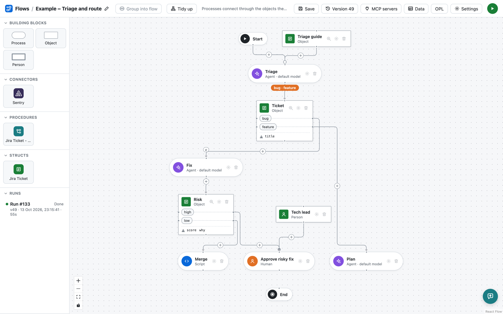
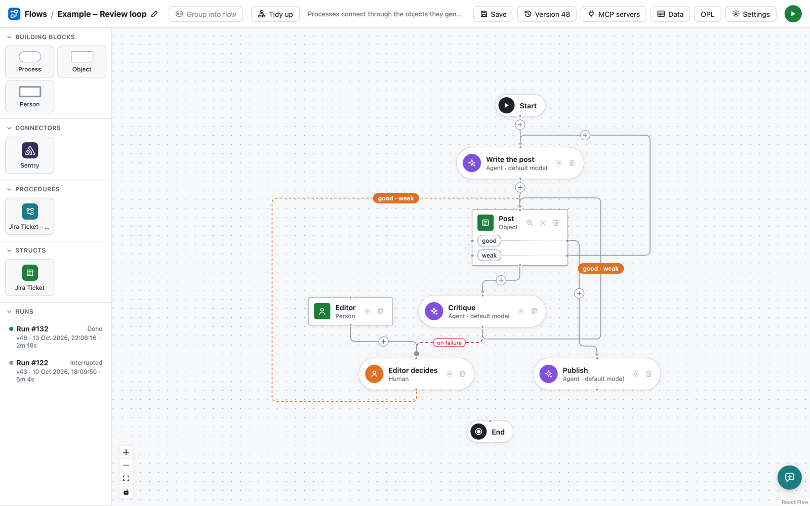
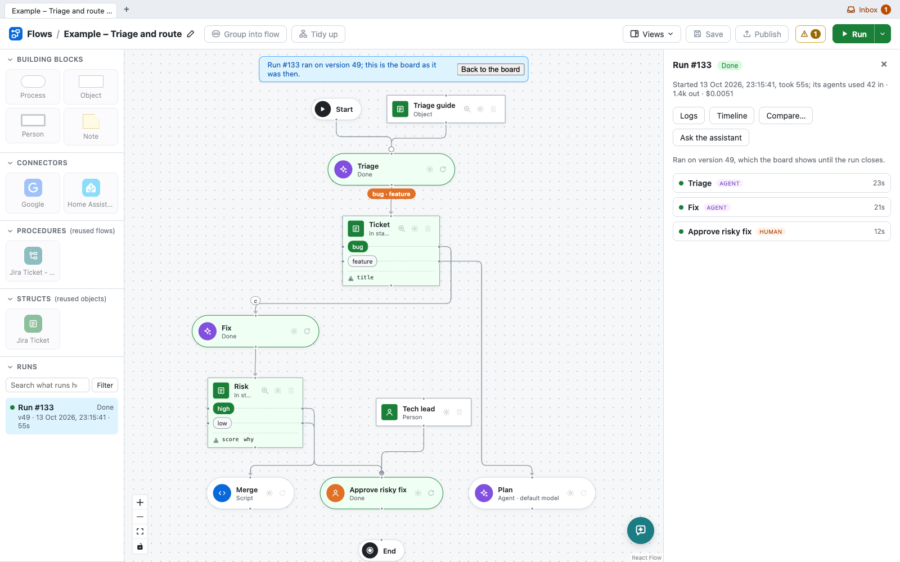

# Spoletta

Spoletta is a visual builder and engine for agent workflows. You draw a flow
on a board, made of the things that happen and the things they work on, and
Spoletta runs it: AI coding agents, bash scripts, people and built-in
connectors such as GitHub and Slack each carry out their part, and every run
is recorded step by step.

The full documentation is at **[spoletta.com/docs](https://spoletta.com/docs)**.



## The idea: OPM

Spoletta is modeled on OPM, the Object-Process Methodology (ISO 19450). OPM
describes any system with just two kinds of thing:

- **Objects** exist, and can be in one of several **states**: a ticket is a
  *bug* or a *feature*, a review is *approved* or has *changes requested*.
- **Processes** transform objects: they create them, use them up, change
  them, or move them to another state.

**Links** join the two and say what each process does to each object. A
process can need an object without changing it (an instrument, such as a
triage guide), consume it, change it, or yield it, possibly in a given
state. An object entering a state can trigger a process, or be a condition
for it to run at all. That is what drives a flow: processes connect through
the objects they generate, not through arrows drawn from one step to the
next.

## What a flow is made of

| Process | Carried out by |
|---|---|
| Agent | an AI coding agent ([pi](https://www.npmjs.com/package/@earendil-works/pi-coding-agent)), optionally in git checkouts of the flow's repositories and with MCP servers |
| Script | bash, with `curl` and `jq` |
| Human | a person in the Spoletta UI, approving, sending work back or filling something in |
| Flow | a board of its own, zoomed into, which can run once per item of a list |
| Subflow | another flow, a procedure reused across jobs |
| Connector | Spoletta itself, carrying out an operation of a built-in connector, such as commenting on a GitHub issue or calling an HTTP API |

Objects hold JSON. Their attributes give it a shape, their parts nest other
objects, and persistent objects remember what earlier runs handled, so the
same Sentry issue isn't fixed twice. A struct defines an object once for
many flows to use.

Loops come naturally: here a critic marks a post *good* or *weak*, a weak
post goes back to be rewritten, and an editor steps in if the critic fails.



## Running

Pressing Run, or a schedule firing, starts a run. The server walks the
board, and each process that runs becomes a step you can open to see what it
took, what it handed back, and for agents the whole session and its cost.
People get the decisions that are theirs to make, by the roles they hold.
Code an agent changes is committed to a branch of the run, and an ended run
can be re-run from any of its processes with what that process took edited.



Each flow also has an assistant, a chat at the bottom right of its board,
that changes the flow for you from a description of what you want. Flows can
be exported and imported as YAML setup files ([webapp/SETUP.md](webapp/SETUP.md)),
and [docs/FLOWS.md](docs/FLOWS.md) explains how to author them.

## Getting started

Spoletta runs as three containers: MySQL, the webapp and the worker that
runs agents and scripts. With [podman](https://podman.io):

```sh
podman compose up --build
```

then open http://localhost:8080.

The worker uses the models in your pi config (`~/.pi/agent/models.json` and
`settings.json`, or `PI_CONFIG_DIR`). Model API keys, a
token to clone the flows' repositories and the OpenID Connect settings for
signing in, with your identity provider, Google or both, go in a `.env` file
next to `compose.yaml`; the comments in [compose.yaml](compose.yaml) list
them all. Without `OIDC_ISSUER` or `GOOGLE_CLIENT_ID` nobody signs in and
anyone reaching the webapp can do anything, so compose publishes it, and
MySQL, only on this machine's loopback; once people sign in, set
`PUBLISH_HOST=0.0.0.0` to reach it from elsewhere. Set `SECRET_KEY`
too, such as `openssl rand -base64 32` makes, to seal the model keys and MCP
tokens kept in the database, and keep it with your backups: the webapp
doesn't start without the key they were sealed with. [docs/SECRETS.md](docs/SECRETS.md)
says how to rotate it.

## Development

| Part | Where | Stack |
|---|---|---|
| Webapp | `webapp/` | Go, stdlib `net/http`, MySQL |
| Frontend | `webapp/frontend/` | React, TypeScript, Vite, React Flow |
| Worker | `worker/` | Go, running pi and bash |

```sh
cd webapp && go build ./... && go vet ./... && go test .
cd webapp && go test -race ./tests      # e2e, needs `podman compose up -d mysql`
cd webapp/frontend && npm run build     # or npm run dev, proxying /api to :8080
```

The webapp migrates its database as it starts; [docs/MIGRATIONS.md](docs/MIGRATIONS.md)
says how to write a migration and how to migrate down to run an older
version. Any number of webapps can run on one database, such as a
Deployment's pods behind one Service; [docs/REPLICAS.md](docs/REPLICAS.md)
says what they share and what happens as one stops. [AGENTS.md](AGENTS.md)
maps the code and its conventions.

## License

Apache License 2.0, see [LICENSE](LICENSE). The name "Spoletta" is not
licensed for use by derivative works; see [NOTICE](NOTICE).
