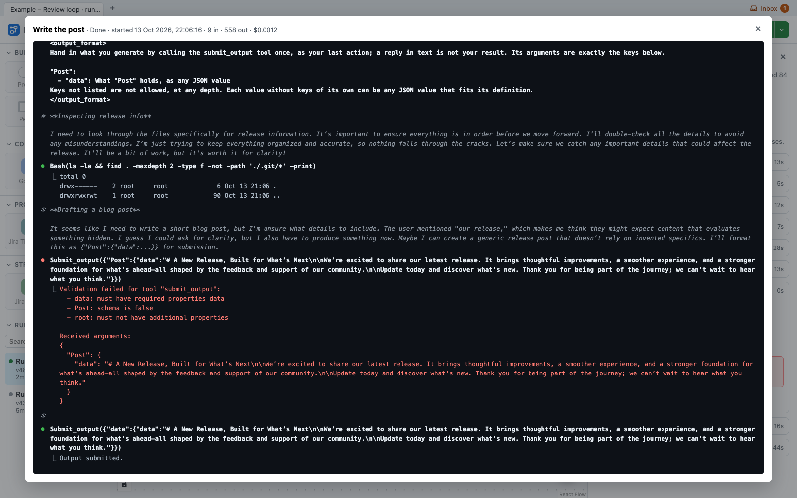
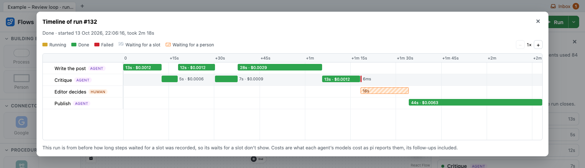
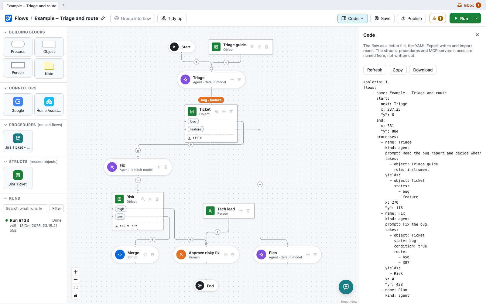

# Spoletta

**Draw how your work moves from state to state. Spoletta runs it, with AI
agents doing the steps in between.**

Spoletta is a visual builder and engine for processes that AI agents, bash
scripts, people and built-in connectors carry out together. You model the
process: what the work is about, the states it goes through, and what moves
it on. Agents are the glue between those states. Each gets one job, with
known inputs and a contract for what it hands back, and the process, not
the agent, decides what happens next.

The full documentation is at **[spoletta.com/docs](https://spoletta.com/docs)**.


## The process is the program

Give an agent a long prompt and every tool, and it may well get there. But
the process is then hidden in a prompt. You can't see where a run is or why
it went one way, nobody can sign off halfway, a failure at the ninth step
means starting again from the first, and changing the process means
rewording the prompt and hoping.

Most of what engineers do already follows a process. A ticket is triaged, a
bug is fixed, a risky change waits for the tech lead, a release is written
up and announced. Each is a state machine nobody wrote down. Spoletta has
you write it down, as a board, and runs it.

The board is modelled on OPM, the Object-Process Methodology (ISO 19450),
which describes any system with two kinds of thing:

- **Objects** are what the work is about: a ticket, a patch, a pull request.
  Each holds JSON with a known shape, and can be in one of several
  **states**, such as *bug* or *feature*, *approved* or *changes requested*.
  An object can be stored, so each run knows what earlier runs handled and
  the same issue isn't worked on twice.
- **Processes** make objects, change them, or move them to another state.
  An AI agent, a bash script, a person or a connector carries out each one.

Processes connect through the objects they make, not through arrows from
one step to the next: a process runs once what it takes exists, or when an
object enters the state it waits for. An agent can be swapped for a script,
or a script for a person, and what comes before and after stays as it is.
So each does what it is best at: a script with `jq` what a rule can decide,
a person the calls that are theirs, and an agent the judgement in between.

## A flow, read back

Every board reads as plain sentences, OPM's Object-Process Language (OPL),
generated from the drawing. This is the flow above:

```
"Ticket" can be "bug" or "feature".
"Ticket" exhibits "title".
"Risk" can be "high" or "low".
"Risk" is "high" when score >= 7.
"Risk" is "low" when score < 7.
"Risk" exhibits "score" and "why".
"Tech lead" is a person.
"Triage" is an agent process, which an AI agent carries out.
"Triage" requires "Triage guide", which it doesn't change.
"Triage" yields "Ticket" as "bug" or "feature", deciding which.
"Fix" is an agent process, which an AI agent carries out.
"Fix" occurs if "Ticket" is "bug", and is skipped otherwise.
"Fix" yields "Risk".
"Merge" is a script process.
"Risk" entering "low" triggers "Merge".
"Approve risky fix" is a human process, which a person carries out.
"Tech lead" handles "Approve risky fix".
"Risk" entering "high" triggers "Approve risky fix".
"Plan" is an agent process, which an AI agent carries out.
"Ticket" entering "feature" triggers "Plan".
The flow starts with "Triage".
```

Look at what picks the branch. Fix only scores its change. Which score is
too risky to merge without the tech lead is the rule `score >= 7`, on the
board, where anyone can read it, change it and see it in the flow's
versions, rather than somewhere in a prompt. Agents can be given these
sentences too, so each knows the process it is part of.


*A run of that flow. Triage marked the ticket a bug, Fix scored its change
10, so Risk came out high and the tech lead decided. Merge and Plan never
ran.*

| A process | is carried out by |
|---|---|
| Agent | an AI coding agent ([pi](https://www.npmjs.com/package/@earendil-works/pi-coding-agent)) on the model you pick, optionally in git checkouts of the flow's repositories, with MCP servers, skills and credentials |
| Script | bash, with `curl` and `jq` |
| Human | a person, approving, sending work back with instructions, or filling something in |
| Connector | Spoletta itself, carrying out one operation of GitHub, Slack, Telegram, Google Sheets and Docs, Home Assistant or any HTTP API |
| Flow | a board of its own, zoomed into, run once or once per item of a list |
| Subflow | another flow, a procedure reused across jobs |

## What engineers get from it

### Contracts between steps

An object's attributes are the contract between the step that makes it and
the steps that take it. An agent hands in its work through a tool that
checks it against the contract; a reply that doesn't fit is sent back once
with what was wrong, and then fails the step. A failure ends its branch, or
goes to a handler you draw. Steps take timeouts and retries, a reviewing
agent that sends work back is held to a number of rounds, and any other loop
asks a person before it goes round too often, or round again on what it
took before. Runs end; they don't spin.


*A writer and a critic. The critic sent the post back three times, the most
its rounds allow, so it failed the fourth time, and the editor took over
through the failure connection drawn from it.*

### Code on a branch, with a trail

Agents work in git checkouts of the flow's repositories. What a step leaves
is committed to the run's branch, with the run, the step and the agent's
session as commit trailers, and the step shows its diff, file by file. A
re-run starts from the commit the branch was at when its process first ran.

### See everything, re-run anything

Each process that runs is a step you can open: what it took, what it handed
back, the agent's whole conversation, the files it changed, its log and what
it cost. Follow a run on a timeline of what ran at once and what waited, or
put two runs side by side to see where they parted. Re-run an ended run from
any process, editing what it takes, or try one process alone on inputs you
give. Search a flow's runs and the values they left with a faceted query such as
`status:failed @Ticket.state:bug started:>now-7d`. And ask the flow's
assistant why run 412 failed: it reads that run's steps, decisions and log.



*A step's terminal. The agent's first hand-in didn't fit the contract, so it
was told what was wrong, and its second was taken.*



*The same review loop on a timeline: the writer and the critic taking turns,
the critic failing, the editor's decision (hatched while it waited for a
person), then Publish.*

### One place to look

Home lists every flow, task board, procedure and struct you see. Each flow
shows its latest runs as a strip, failures standing tallest in red, a click
on one opening that run, and chips count the flows failing, running or
waiting on you, each narrowing the list to them. Search finds anything by
name or tag: `/` goes there, Enter opens the first found. A side menu
narrows to a kind, a tag or an owner, and stays beside Activity, which
charts runs, failures, spending and how long reviews take across every
flow.

Task boards lay shared structs' records out in columns, each a struct and a
query of its records, such as Jira tickets `state:new` beside pull requests
`state:in_review`. As a flow or a person moves a record into another state it
moves to that column, so the states a flow works through read as its queue,
and a card opens its record to correct it or starts a flow on it.

### People where they count

A review goes to the people whose role it names ("Finance handles Approve
payment"). It shows in their inbox, across every flow, and they are told by
email or on Slack, reminded while it waits, and past a time limit it fails
over to the handler you drew: an escalation, say, or an agent making a
default decision.

### Versioned like code

Every save is a version, and any two can be diffed. Publish one, and
schedules, webhooks and the HTTP API run it while you go on editing the
draft; publish an older one to roll back. The board lists what is wrong
with a flow before it runs. The whole setup (flows, procedures, structs,
skills and MCP servers) exports as a YAML file to keep in git, review in a
pull request or have a model write. And each flow has an assistant that
changes it from a description of what you want, then highlights what it
changed.



*Every board is a setup file too: the flow above, as YAML.*

### Safe to let loose

Agents and scripts run code nobody reviewed. They never hold a model key or
a credential's secret: they reach models, MCP servers and your services
through the webapp's proxies, with tokens that end with the step. Outside
development, each step also runs in a container or Kubernetes pod of its
own, which sees only its own directories and reaches only the webapp, and
through it the internet only at the hosts admins allow. Admins cap what a
run and a person may spend, and an audit log records every token handed out
and every call through a credential.

### Built to stay up

A Go webapp on MySQL, with few dependencies. Run as many replicas as you
like on one database: a run whose replica stops for a deploy is taken over
by another and carries on from what it stored, its reviews still waiting.
Other systems start flows over an HTTP API with idempotency keys, or
through signed webhooks from GitHub, Slack or anything else, and flows run
on schedules.

## What to build with it

Six flows ship as templates to start from:

- **Triage a ticket**: an agent decides whether a ticket reports a bug or
  asks for a feature, and a fix is attempted or a spec written.
- **Fix with an approval by risk**: an agent fixes a bug and rates its
  change; a low-risk fix goes straight to a pull request, a risky one waits
  for the tech lead.
- **Write and critique**: one agent writes, another critiques until it is
  good, and an editor decides once the critic gives up.
- **Daily digest to Slack**: every weekday morning, an agent sums up what a
  channel said the day before and posts it.
- **Answer each question of a list**: an agent answers each question in a
  run of its own, and another gathers the answers into one page.
- **Expense claim**: a rule approves a small claim, finance a larger one.

The [authoring guide](docs/FLOWS.md#8-worked-examples) works through more:
fixing the top Sentry errors every weekday, each on a branch of its own and
never the same issue twice; release notes with a person's sign-off; a
quorum of reviewers.

## Try it

```sh
podman compose up --build
```

Then open http://localhost:8080 and start from a template.
[docs/INSTALL.md](docs/INSTALL.md) covers models, repositories, signing in,
secrets and running steps in a sandbox.

## Documentation

- [The user manual](https://spoletta.com/docs): building and running flows
  in the app.
- [Installing](docs/INSTALL.md): running Spoletta, and what to set before
  others reach it.
- [Authoring flows](docs/FLOWS.md): OPM as Spoletta uses it, how a run goes,
  what each step sees and hands in, and worked examples.
- [Setup files](webapp/SETUP.md): the YAML format, field by field.
- [Sandboxes](docs/SANDBOX.md): the threat model, what a step can reach, and
  Podman, Docker and Kubernetes.
- [Secrets](docs/SECRETS.md): how the database keeps secrets sealed, and
  rotating `SECRET_KEY`.
- [Replicas](docs/REPLICAS.md): running several webapps on one database.
- [Migrations](docs/MIGRATIONS.md): writing one, and migrating down to run
  an older version.
- [Development](docs/DEVELOPMENT.md): building, testing and the code's
  layout.

## License

Apache License 2.0, see [LICENSE](LICENSE). The name "Spoletta" is not
licensed for use by derivative works; see [NOTICE](NOTICE).
